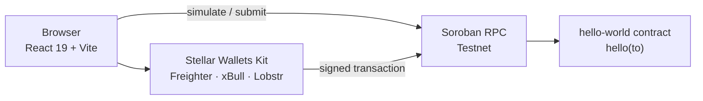
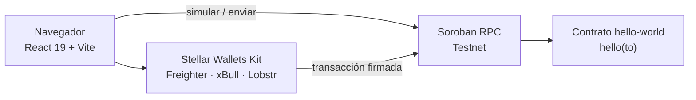
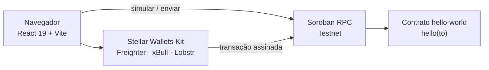

<div align="center">

# Stellar Hello World

**A full-stack Soroban reference project — on-chain contract, React dApp, testnet deployment and CI.**

[](https://github.com/alucart2005/HelloWorldWeb3/actions/workflows/ci.yml)
[](https://developers.stellar.org/docs/build/smart-contracts/overview)
[](https://nodejs.org)
[](https://www.rust-lang.org/tools/install)

**[English](#en)** · **[Español](#es)** · **[Português](#pt)**

</div>

---

<a id="en"></a>

## 🇬🇧 English

### Overview

HelloWorld is a minimal but production-shaped Soroban project: a smart contract written in Rust, a React single-page dApp that simulates, signs and submits transactions through real Stellar wallets, and a CI pipeline that keeps everything honest on every push.

Everything targets **Soroban Testnet** — safe to experiment with, no real XLM required.

### Highlights

- **Contract** `hello-world` exposing `hello(to: String) -> Vec<String>`, built with `soroban-sdk` 28 and compiled to a 633-byte WASM module.
- **dApp** built with React 19, Vite 8, TypeScript 6 and Tailwind CSS 4, connected to the network through **Stellar Wallets Kit** (Freighter, xBull and Lobstr).
- **Two-step call flow**: simulation first, then signing and submission, with the return value decoded from the transaction metadata.
- **Performance**: the initial payload is **226 kB (71 kB gzipped)**; the 794 kB Stellar SDK vendor chunk and every wallet module are loaded on demand.
- **CI on every push**: unit tests, `clippy -D warnings`, WASM build, type-check, lint, production build and a dependency audit gate.

### Architecture



### Tech stack

| Layer | Tools |
| --- | --- |
| Smart contract | Rust, `soroban-sdk` 28, Stellar CLI 28, `wasm32v1-none` |
| Frontend | React 19, Vite 8, TypeScript 6, Tailwind CSS 4, oxlint |
| Stellar integration | `@stellar/stellar-sdk` 17, `@creit.tech/stellar-wallets-kit` 2.7 |
| Quality | `cargo test`, `cargo clippy -D warnings`, `tsc -b`, oxlint, `npm audit` |
| Automation | GitHub Actions (`.github/workflows/ci.yml`), Node 24 pinned via `.nvmrc` |

### Prerequisites

| Tool | Version | Purpose |
| --- | --- | --- |
| [Rust](https://www.rust-lang.org/tools/install) | 1.84 or newer | contract compilation |
| `wasm32v1-none` target | — | `rustup target add wasm32v1-none` |
| [Stellar CLI](https://developers.stellar.org/docs/tools/cli/install-cli) | 28.x | build, deploy and invoke |
| [Node.js](https://nodejs.org) | 24 or newer | frontend toolchain (`.nvmrc`) |
| Git | any | version control |

```bash
curl -fsSL https://github.com/stellar/stellar-cli/raw/main/install.sh | sh
rustup target add wasm32v1-none
```

### Quick start

```bash
git clone https://github.com/alucart2005/HelloWorldWeb3.git
cd HelloWorld

# Frontend dependencies (Node 24 — see .nvmrc)
node --version
npm --prefix soroban-hello-world/frontend ci

# Dev server → http://localhost:5173
npm run dev
```

Everyday commands, run from the repository root:

| Command | What it does |
| --- | --- |
| `npm run dev` | start Vite with hot reload |
| `npm run build` | type-check and build the production bundle |
| `npm run lint` | run oxlint |
| `npm run test` | run the contract unit tests |
| `npm run contract:build` | compile the contract to WASM |
| `npm run audit` | fail on high/critical advisories |

### Smart contract

```rust
#[contractimpl]
impl Contract {
    pub fn hello(env: Env, to: String) -> Vec<String> {
        vec![&env, String::from_str(&env, "Hello"), to]
    }
}
```

```bash
cd soroban-hello-world
cargo test                       # host-side unit tests
stellar contract build           # → target/wasm32v1-none/release/hello_world.wasm

# Deploy to testnet
stellar contract deploy \
  --wasm target/wasm32v1-none/release/hello_world.wasm \
  --source-account <identity> \
  --network testnet \
  --alias hello

# Invoke it
stellar contract invoke --id hello --network testnet \
  --source-account <identity> -- hello --to world
```

**Deployed instance (Testnet)**

| Field | Value |
| --- | --- |
| Contract ID | `CBDKHW25QO3IMWWXVLBHHPMRLMFS7W7HCSYOY4A4Z2HMKAIKPZJMSCQE` |
| Wasm SHA-256 | `97f127cc24d2ba1d966176192f68e0a97a6cbac592fb443884c6062b7f12bbd0` |
| RPC endpoint | `https://soroban-testnet.stellar.org` |
| Network passphrase | `Test SDF Network ; September 2015` |

### Frontend configuration

Copy the example file and adjust the values if you redeploy:

```bash
cp soroban-hello-world/frontend/.env.example soroban-hello-world/frontend/.env
```

| Variable | Description | Default |
| --- | --- | --- |
| `VITE_CONTRACT_ID` | Deployed contract address | testnet instance above |
| `VITE_SOROBAN_RPC_URL` | Soroban RPC endpoint | `https://soroban-testnet.stellar.org` |
| `VITE_NETWORK_PASSPHRASE` | Network passphrase used to sign | `Test SDF Network ; September 2015` |

The `.env` file is git-ignored; only `.env.example` is tracked.

### Project structure

```text
HelloWorld/
├── .github/workflows/ci.yml     # CI: contract + frontend jobs
├── .nvmrc                       # Node 24
├── README.md                    # this file (EN · ES · PT)
├── package.json                 # scripts-only entry point (no dependencies)
└── soroban-hello-world/
    ├── Cargo.toml               # Rust workspace
    ├── AGENTS.md                # contributor instructions
    ├── contracts/hello-world/
    │   ├── src/lib.rs           # contract implementation
    │   └── src/test.rs          # unit tests
    └── frontend/
        ├── src/App.tsx          # dApp UI + wallet/RPC logic
        ├── .env.example         # environment template
        └── vite.config.ts
```

### Continuous integration

`.github/workflows/ci.yml` runs two parallel jobs on every push and pull request to `main`:

1. **Contract** — `cargo test`, `cargo clippy --all-targets -- -D warnings`, `stellar contract build`, and the resulting WASM uploaded as a build artifact.
2. **Frontend** — `npm ci`, oxlint, `tsc -b && vite build`, and `npm audit --audit-level=high` as a release gate.

### Security notes

- No secrets, mnemonics or private keys are stored in this repository; Stellar identities live in `~/.config/stellar/identity/` with `0600` permissions.
- `.env`, `.env.*` and editor lock files are ignored by git.
- The contract is read-only: it holds no state and performs no privileged operation.
- Transitive advisories in the wallet kit dependency tree (`uuid`, `stream-json`, `bs58`) are pinned through `overrides`; the remaining 5 **low** findings come from `elliptic`, upstream with no published fix, and none of them reach the shipped bundle.

---

<a id="es"></a>

## 🇪🇸 Español

### Descripción

HelloWorld es un proyecto Soroban mínimo con forma de producción: un contrato inteligente en Rust, una dApp de página única en React que simula, firma y envía transacciones mediante billeteras reales de Stellar, y un pipeline de CI que lo verifica todo en cada push.

Todo apunta a la **Testnet de Soroban** — se puede experimentar sin XLM real.

### Destacados

- **Contrato** `hello-world` con `hello(to: String) -> Vec<String>`, construido con `soroban-sdk` 28 y compilado a un módulo WASM de 633 bytes.
- **dApp** con React 19, Vite 8, TypeScript 6 y Tailwind CSS 4, conectada a la red mediante **Stellar Wallets Kit** (Freighter, xBull y Lobstr).
- **Flujo de llamada en dos pasos**: primero simulación, luego firma y envío, decodificando el valor de retorno desde los metadatos de la transacción.
- **Rendimiento**: la carga inicial es de **226 kB (71 kB comprimido)**; el chunk del SDK de 794 kB y cada módulo de billetera se cargan bajo demanda.
- **CI en cada push**: pruebas unitarias, `clippy -D warnings`, compilación WASM, verificación de tipos, lint, build de producción y control de vulnerabilidades.

### Arquitectura



### Stack tecnológico

| Capa | Herramientas |
| --- | --- |
| Contrato inteligente | Rust, `soroban-sdk` 28, Stellar CLI 28, `wasm32v1-none` |
| Frontend | React 19, Vite 8, TypeScript 6, Tailwind CSS 4, oxlint |
| Integración Stellar | `@stellar/stellar-sdk` 17, `@creit.tech/stellar-wallets-kit` 2.7 |
| Calidad | `cargo test`, `cargo clippy -D warnings`, `tsc -b`, oxlint, `npm audit` |
| Automatización | GitHub Actions, Node 24 fijado en `.nvmrc` |

### Requisitos previos

| Herramienta | Versión | Uso |
| --- | --- | --- |
| [Rust](https://www.rust-lang.org/tools/install) | 1.84 o superior | compilar el contrato |
| Target `wasm32v1-none` | — | `rustup target add wasm32v1-none` |
| [Stellar CLI](https://developers.stellar.org/docs/tools/cli/install-cli) | 28.x | build, deploy e invoke |
| [Node.js](https://nodejs.org) | 24 o superior | toolchain del frontend (`.nvmrc`) |
| Git | cualquiera | control de versiones |

```bash
curl -fsSL https://github.com/stellar/stellar-cli/raw/main/install.sh | sh
rustup target add wasm32v1-none
```

### Inicio rápido

```bash
git clone https://github.com/alucart2005/HelloWorldWeb3.git
cd HelloWorld

# Dependencias del frontend (Node 24 — ver .nvmrc)
node --version
npm --prefix soroban-hello-world/frontend ci

# Servidor de desarrollo → http://localhost:5173
npm run dev
```

Comandos habituales, ejecutados desde la raíz del repositorio:

| Comando | Qué hace |
| --- | --- |
| `npm run dev` | arranca Vite con recarga en caliente |
| `npm run build` | verifica tipos y genera el bundle de producción |
| `npm run lint` | ejecuta oxlint |
| `npm run test` | ejecuta las pruebas unitarias del contrato |
| `npm run contract:build` | compila el contrato a WASM |
| `npm run audit` | falla con avisos altos o críticos |

### Contrato inteligente

```rust
#[contractimpl]
impl Contract {
    pub fn hello(env: Env, to: String) -> Vec<String> {
        vec![&env, String::from_str(&env, "Hello"), to]
    }
}
```

```bash
cd soroban-hello-world
cargo test                       # pruebas unitarias en host
stellar contract build           # → target/wasm32v1-none/release/hello_world.wasm

# Despliegue en testnet
stellar contract deploy \
  --wasm target/wasm32v1-none/release/hello_world.wasm \
  --source-account <identidad> \
  --network testnet \
  --alias hello

# Invocación
stellar contract invoke --id hello --network testnet \
  --source-account <identidad> -- hello --to world
```

**Instancia desplegada (Testnet)**

| Campo | Valor |
| --- | --- |
| ID del contrato | `CBDKHW25QO3IMWWXVLBHHPMRLMFS7W7HCSYOY4A4Z2HMKAIKPZJMSCQE` |
| SHA-256 del WASM | `97f127cc24d2ba1d966176192f68e0a97a6cbac592fb443884c6062b7f12bbd0` |
| Endpoint RPC | `https://soroban-testnet.stellar.org` |
| Frase de red | `Test SDF Network ; September 2015` |

### Configuración del frontend

```bash
cp soroban-hello-world/frontend/.env.example soroban-hello-world/frontend/.env
```

| Variable | Descripción | Valor predeterminado |
| --- | --- | --- |
| `VITE_CONTRACT_ID` | dirección del contrato desplegado | instancia de testnet |
| `VITE_SOROBAN_RPC_URL` | endpoint de Soroban RPC | `https://soroban-testnet.stellar.org` |
| `VITE_NETWORK_PASSPHRASE` | frase de red para firmar | `Test SDF Network ; September 2015` |

El archivo `.env` está ignorado por git; solo se versiona `.env.example`.

### Estructura del proyecto

```text
HelloWorld/
├── .github/workflows/ci.yml     # CI: trabajos de contrato y frontend
├── .nvmrc                       # Node 24
├── README.md                    # este archivo (EN · ES · PT)
├── package.json                 # solo scripts, sin dependencias
└── soroban-hello-world/
    ├── Cargo.toml               # workspace de Rust
    ├── AGENTS.md                # instrucciones para colaboradores
    ├── contracts/hello-world/
    │   ├── src/lib.rs           # implementación del contrato
    │   └── src/test.rs          # pruebas unitarias
    └── frontend/
        ├── src/App.tsx          # interfaz y lógica de billetera/RPC
        ├── .env.example         # plantilla de entorno
        └── vite.config.ts
```

### Integración continua

Dos trabajos en paralelo en cada push y pull request hacia `main`:

1. **Contrato** — `cargo test`, `cargo clippy --all-targets -- -D warnings`, `stellar contract build` y subida del WASM como artefacto.
2. **Frontend** — `npm ci`, oxlint, `tsc -b && vite build` y `npm audit --audit-level=high` como puerta de control.

### Notas de seguridad

- No hay secretos, mnemotécnicos ni claves privadas en el repositorio; las identidades viven en `~/.config/stellar/identity/` con permisos `0600`.
- `.env`, `.env.*` y los archivos de bloqueo del editor están ignorados por git.
- El contrato es de solo lectura: no guarda estado ni realiza operaciones privilegiadas.
- Las vulnerabilidades transitivas del árbol de dependencias de la billetera (`uuid`, `stream-json`, `bs58`) se fijan mediante `overrides`; los 5 avisos **bajos** restantes provienen de `elliptic`, sin corrección publicada, y ninguno llega al bundle entregado.

---

<a id="pt"></a>

## 🇧🇷 Português

### Visão geral

HelloWorld é um projeto Soroban mínimo com cara de produção: um contrato inteligente em Rust, uma dApp de página única em React que simula, assina e envia transações por meio de carteiras Stellar reais, e um pipeline de CI que verifica tudo a cada push.

Tudo aponta para a **Testnet do Soroban** — é seguro experimentar, sem XLM real.

### Destaques

- **Contrato** `hello-world` com `hello(to: String) -> Vec<String>`, construído com `soroban-sdk` 28 e compilado para um módulo WASM de 633 bytes.
- **dApp** com React 19, Vite 8, TypeScript 6 e Tailwind CSS 4, conectada à rede pelo **Stellar Wallets Kit** (Freighter, xBull e Lobstr).
- **Fluxo de chamada em duas etapas**: primeiro a simulação, depois assinatura e envio, com o valor de retorno decodificado dos metadados da transação.
- **Desempenho**: a carga inicial é de **226 kB (71 kB comprimida)**; o chunk de 794 kB do SDK Stellar e cada módulo de carteira são carregados sob demanda.
- **CI a cada push**: testes unitários, `clippy -D warnings`, build WASM, verificação de tipos, lint, build de produção e verificação de vulnerabilidades.

### Arquitetura



### Stack tecnológica

| Camada | Ferramentas |
| --- | --- |
| Contrato inteligente | Rust, `soroban-sdk` 28, Stellar CLI 28, `wasm32v1-none` |
| Frontend | React 19, Vite 8, TypeScript 6, Tailwind CSS 4, oxlint |
| Integração Stellar | `@stellar/stellar-sdk` 17, `@creit.tech/stellar-wallets-kit` 2.7 |
| Qualidade | `cargo test`, `cargo clippy -D warnings`, `tsc -b`, oxlint, `npm audit` |
| Automação | GitHub Actions, Node 24 fixado em `.nvmrc` |

### Pré-requisitos

| Ferramenta | Versão | Finalidade |
| --- | --- | --- |
| [Rust](https://www.rust-lang.org/tools/install) | 1.84 ou superior | compilar o contrato |
| Target `wasm32v1-none` | — | `rustup target add wasm32v1-none` |
| [Stellar CLI](https://developers.stellar.org/docs/tools/cli/install-cli) | 28.x | build, deploy e invoke |
| [Node.js](https://nodejs.org) | 24 ou superior | toolchain do frontend (`.nvmrc`) |
| Git | qualquer | controle de versão |

```bash
curl -fsSL https://github.com/stellar/stellar-cli/raw/main/install.sh | sh
rustup target add wasm32v1-none
```

### Início rápido

```bash
git clone https://github.com/alucart2005/HelloWorldWeb3.git
cd HelloWorld

# Dependências do frontend (Node 24 — ver .nvmrc)
node --version
npm --prefix soroban-hello-world/frontend ci

# Servidor de desenvolvimento → http://localhost:5173
npm run dev
```

Comandos do dia a dia, executados na raiz do repositório:

| Comando | O que faz |
| --- | --- |
| `npm run dev` | inicia o Vite com hot reload |
| `npm run build` | verifica tipos e gera o bundle de produção |
| `npm run lint` | executa o oxlint |
| `npm run test` | executa os testes unitários do contrato |
| `npm run contract:build` | compila o contrato para WASM |
| `npm run audit` | falha em avisos altos ou críticos |

### Contrato inteligente

```rust
#[contractimpl]
impl Contract {
    pub fn hello(env: Env, to: String) -> Vec<String> {
        vec![&env, String::from_str(&env, "Hello"), to]
    }
}
```

```bash
cd soroban-hello-world
cargo test                       # testes unitários no host
stellar contract build           # → target/wasm32v1-none/release/hello_world.wasm

# Deploy na testnet
stellar contract deploy \
  --wasm target/wasm32v1-none/release/hello_world.wasm \
  --source-account <identidade> \
  --network testnet \
  --alias hello

# Invocação
stellar contract invoke --id hello --network testnet \
  --source-account <identidade> -- hello --to world
```

**Instância implantada (Testnet)**

| Campo | Valor |
| --- | --- |
| ID do contrato | `CBDKHW25QO3IMWWXVLBHHPMRLMFS7W7HCSYOY4A4Z2HMKAIKPZJMSCQE` |
| SHA-256 do WASM | `97f127cc24d2ba1d966176192f68e0a97a6cbac592fb443884c6062b7f12bbd0` |
| Endpoint RPC | `https://soroban-testnet.stellar.org` |
| Frase da rede | `Test SDF Network ; September 2015` |

### Configuração do frontend

```bash
cp soroban-hello-world/frontend/.env.example soroban-hello-world/frontend/.env
```

| Variável | Descrição | Valor padrão |
| --- | --- | --- |
| `VITE_CONTRACT_ID` | endereço do contrato implantado | instância de testnet |
| `VITE_SOROBAN_RPC_URL` | endpoint do Soroban RPC | `https://soroban-testnet.stellar.org` |
| `VITE_NETWORK_PASSPHRASE` | frase da rede para assinar | `Test SDF Network ; September 2015` |

O arquivo `.env` é ignorado pelo git; apenas `.env.example` é versionado.

### Estrutura do projeto

```text
HelloWorld/
├── .github/workflows/ci.yml     # CI: jobs de contrato e frontend
├── .nvmrc                       # Node 24
├── README.md                    # este arquivo (EN · ES · PT)
├── package.json                 # apenas scripts, sem dependências
└── soroban-hello-world/
    ├── Cargo.toml               # workspace Rust
    ├── AGENTS.md                # instruções para colaboradores
    ├── contracts/hello-world/
    │   ├── src/lib.rs           # implementação do contrato
    │   └── src/test.rs          # testes unitários
    └── frontend/
        ├── src/App.tsx          # interface e lógica de carteira/RPC
        ├── .env.example         # modelo de ambiente
        └── vite.config.ts
```

### Integração contínua

Dois trabalhos em paralelo a cada push e pull request para `main`:

1. **Contrato** — `cargo test`, `cargo clippy --all-targets -- -D warnings`, `stellar contract build` e upload do WASM como artefato.
2. **Frontend** — `npm ci`, oxlint, `tsc -b && vite build` e `npm audit --audit-level=high` como porta de controle.

### Notas de segurança

- Não há segredos, mnemônicos ou chaves privadas neste repositório; as identidades Stellar ficam em `~/.config/stellar/identity/` com permissões `0600`.
- `.env`, `.env.*` e arquivos de bloqueio de editor são ignorados pelo git.
- O contrato é somente leitura: não guarda estado nem executa operações privilegiadas.
- As vulnerabilidades transitivas da árvore de dependências da carteira (`uuid`, `stream-json`, `bs58`) são fixadas via `overrides`; os 5 avisos **baixos** restantes vêm do `elliptic`, sem correção publicada, e nenhum deles chega ao bundle entregue.
